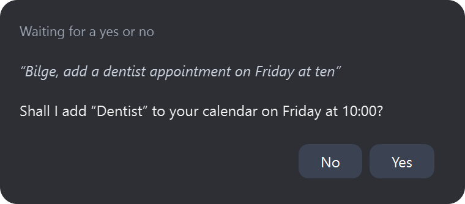
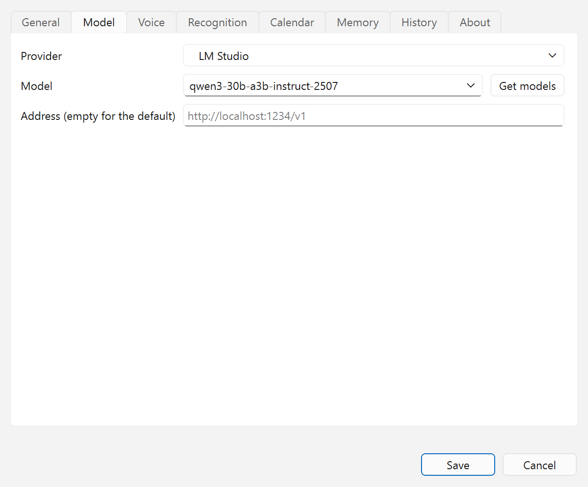
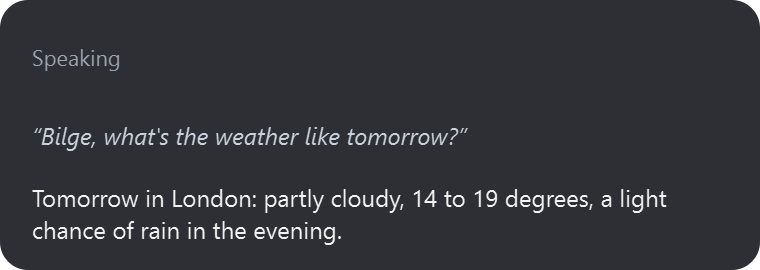

<p align="center">
  
</p>

<h1 align="center">Bilge for Windows and Linux</h1>

<p align="center">
  A voice assistant that speaks Turkish and English, for Windows and Linux.
</p>

<p align="center">
  <a href="LICENSE"></a>
  
  
  
</p>

<p align="center">
  <b>English</b> · <a href="README.tr.md">Türkçe</a>
</p>

<p align="center">
  
</p>

It is the sibling of [Bilge for macOS](https://github.com/coderssociety/bilge-assistant): the same assistant and
the same rules (say “Bilge”, it asks before anything risky), rebuilt in Python because the Mac version is made of
Apple-only parts.

Unlike the Mac version, the language model can be a hosted API as well as a local one, chosen per setup:

| | Local | Hosted API |
|---|---|---|
| Language model | Ollama, LM Studio, llama.cpp | OpenAI, Anthropic, Google Gemini, OpenRouter, Groq, DeepSeek |

API keys are kept in the system's key store (Windows Credential Manager, the Secret Service on Linux), never
in a plain file.

## Status

All five phases are done; 0.1.1 is the first release.

1. **Core** (done): the Turkish and English parsers from the Mac version with the same test cases, the
   tool-calling agent with confirmations and prompt-injection rules, and a text chat to try it.
2. **Voice** (done): wake word or shortcut, speech recognition (Whisper on the processor or a graphics card, or
   the OpenAI or Groq API), the Supertonic-3 voice, echo cancellation so you can cut in, and voice recognition of
   the owner.
3. **Linux tools** (done): apps, volume, music players, files and documents, typing and dictation, timers,
   calendar and reminders, LibreOffice Calc, system controls.
4. **Windows tools** (done): the same, plus Excel, Outlook mail and Outlook's calendar and tasks.
5. **The app** (done): a tray icon, a corner window showing the conversation, settings, first-run setup, a
   Windows installer and a Linux AppImage.

## Screenshots

<table>
  <tr>
    <td width="50%"></td>
    <td width="50%"></td>
  </tr>
  <tr>
    <td align="center">Setup starts with the language: Türkçe or English.</td>
    <td align="center">The wake word, a listening shortcut, the corner window and update checks.</td>
  </tr>
  <tr>
    <td width="50%"></td>
    <td width="50%"></td>
  </tr>
  <tr>
    <td align="center">A model on this computer (LM Studio, Ollama, llama.cpp) or a hosted API.</td>
    <td align="center">Whisper on the processor or a graphics card, its speed, and your voice.</td>
  </tr>
  <tr>
    <td colspan="2" align="center"></td>
  </tr>
  <tr>
    <td colspan="2" align="center">The corner window shows what it heard and what it answered.</td>
  </tr>
</table>

The pictures are of Windows 11; on Linux the windows take the desktop's own look. `scripts/screenshots.py`
makes them again from the app's real windows, with sample settings.

## Installing

- **Windows 10/11 (64-bit):** run `Bilge-Setup-<version>.exe` from the releases. It installs for your user only,
  without administrator rights, and can start Bilge with Windows.
- **Linux:** download `Bilge-<version>-x86_64.AppImage` (or `aarch64`), make it executable and run it. It needs
  glibc 2.34 or newer (Ubuntu 22.04+, Debian 12+, Fedora 36+) for x86_64, 2.39 for arm64. On GNOME the tray icon
  needs the AppIndicator extension (Ubuntu has it); without it Bilge opens a small window instead.

On first start, setup asks for the language, the language model, speech recognition, and downloads the voice
models (1-2 GB). After that Bilge sits in the tray: say “Bilge” and your request. `Bilge.AppImage cli …` and
`bilge-cli.exe` give the command line below.

## Trying it from source

Needs Python 3.12 and [uv](https://docs.astral.sh/uv/).

```bash
uv sync
uv run bilge use lmstudio <model id>       # or: openai, anthropic, gemini, openrouter, groq, deepseek, ollama
uv run bilge key openai                    # hosted providers only; stored in the system key store
uv run bilge chat                          # by typing
uv run bilge listen                        # by voice; downloads the voice models the first time
uv sync --extra app && uv run bilge-app    # the tray app with setup and settings
```

`uv run bilge models` lists the chosen provider's models.

## Calling Bilge

Say “Bilge”, or press the listening shortcut chosen under Settings → General; pressing it while Bilge talks stops
it. With a shortcut chosen, the wake word can be turned off, and then nothing is transcribed until the shortcut is
pressed. Windows and X11 desktops take the shortcut directly; on Wayland the desktop asks you to approve it (KDE
Plasma 5.27+, GNOME 48+), once; on KDE it can be changed later under System Settings → Shortcuts. Where it can't, and
on Hyprland, which takes the request but binds no key itself, give `Bilge --listen` (the settings show the full
command) a shortcut in the desktop's own keyboard settings.

## Speech recognition

Whisper on the computer runs on the processor, on an NVIDIA card through CUDA when CUDA 12 and cuDNN 9 are
installed, or on any graphics card (AMD, Intel or NVIDIA) through whisper.cpp with Vulkan, which the installers
include. Automatic uses a dedicated card when there is one; Settings → Recognition can pick a card built into the
processor too, or the processor alone. On a card the model is a separate download of about 870 MB.
“Measure speed” there times one request in each place, so the numbers show which to pick. The large model can also
be let go after 10, 30 or 60 minutes without a request; Bilge still hears its name, and only the first request
after that waits a few seconds while the model loads again.

A recording with nothing louder than its own background is not transcribed, and the subtitle credits Whisper
invents for silence (“Altyazı M.K.”, “Thanks for watching!”) are dropped from what it writes.

## Updates

Once a day Bilge asks GitHub for the newest release; a newer one shows up in the tray menu with a link to its
page. Nothing is downloaded or installed by itself. Settings → General turns this off.

## What it can do

| | Examples | On Linux | On Windows |
|---|---|---|---|
| Apps | “Firefox'u aç”, “hesap makinesini kapat”, “açık uygulamalar neler” | menu entries, `gio` | the Start menu |
| Sound | “sesi yüzde 30 yap”, “müziği durdur”, “ne çalıyor” | `wpctl`, `pactl` or `amixer`; MPRIS players | Core Audio; the system media controls |
| Files | “kira sözleşmesini bul”, “son indirdiğim PDF'i özetle”, “eski faturayı çöpe at” | the freedesktop trash | the Recycle Bin |
| Typing | “şunu yaz: …”, “dikte modunu başlat” | `xdotool` (X11), `wtype` or `ydotool` (Wayland) | built in |
| Calendar | “yarın neler var”, “cuma 10'da diş hekimi ekle”, “süt almayı işaretle” | CalDAV or an iCal address | the same, or Outlook |
| Spreadsheet | “D3'e B2 ile B1'i topla”, “C5'e 1250 yaz”, “geri al” | LibreOffice Calc (`python3-uno`) | Excel or LibreOffice Calc |
| Mail | “okunmamış e-postalarım”, “Ahmet'e yarın geleceğimi yaz” | | Outlook |
| System | “ekranı kilitle”, “karanlık modu aç”, “Wi-Fi'ı kapat”, “ekran görüntüsü al”, “pil kaç” | `loginctl`, `gsettings` or Plasma, `nmcli`, the desktop's screenshot tool | built in |
| Clipboard | “panoda ne var”, “seçili metni çevir”, “bunu kopyala” | `wl-clipboard`, `xclip` or `xsel` | built in |
| Other | timers and alarms, opening sites and searches, the daily briefing | | |

Moving files to the trash, closing apps, writing over a filled cell, adding to the calendar or turning Wi-Fi off
asks first, and so does anything that could carry text Bilge has read somewhere else. An e-mail is read out, with the
address it goes to, before it is sent. Typing is refused in terminals,
code editors, remote desktops, virtual machines and password managers. GNOME on Wayland doesn't tell other
programs which window is in front, so there Bilge asks before typing.

### Connecting a calendar

```bash
uv run bilge calendar caldav https://cloud.example.org/remote.php/dav --user ayse   # Nextcloud, iCloud, Fastmail…
uv run bilge calendar ics                   # read-only: e.g. Google Calendar's "secret address in iCal format"
uv run bilge calendar outlook               # Windows: Outlook's calendar and tasks, while Outlook is open
uv run bilge calendar off
```

The password (use an app password where the service has them) and the secret address are typed hidden and kept
in the system key store. CalDAV is only spoken to over HTTPS, except a server on the same computer.

## Development

```bash
uv run pytest
uv run ruff check src tests && uv run ruff format --check src tests
```

`bench/` holds the command sets used to measure routing in the Mac version. `scripts/linux-check` runs the
whole suite on Ubuntu, plus tests that drive the real programs (typing, clipboard, sound, an MPRIS player,
notifications, LibreOffice Calc…) on a screenless desktop:

```bash
docker build -t bilge-linux-check scripts/linux-check
docker run --rm -v "$PWD":/src:ro bilge-linux-check
```

Installers are built by `.github/workflows/release.yml` on a version tag: PyInstaller (`packaging/bilge.spec`),
Inno Setup on Windows (`packaging/windows/bilge.iss`) and an AppImage built in Docker (`packaging/linux`). Both
include whisper.cpp's server built with Vulkan (`packaging/whisper`); a build without it runs Whisper on the
processor or an NVIDIA card only. To try a card from source, put a `whisper-server` on `PATH` or name it in
`BILGE_WHISPER_SERVER`.

On Windows, `tests/windows` does the same against the signed-in desktop (it opens and closes a few windows):

```powershell
$env:BILGE_REAL_DESKTOP = 1; uv run pytest tests/windows
```

## License

GPL-3.0, see [LICENSE](LICENSE).
